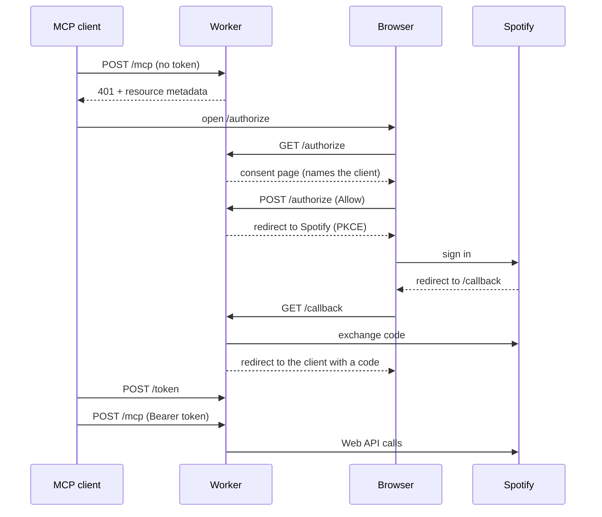

# Spotify Organiser MCP server

A Cloudflare Worker that lets MCP clients (Claude, ChatGPT, Cursor, VS Code, Claude Code) use a person's Spotify account through Spotify Organiser's Spotify app.

It uses the same MCP stack as Macromaxxing: Hono routes, MCP SDK v1 with a stateless `WebStandardStreamableHTTPServerTransport` and `CfWorkerJsonSchemaValidator`, and tools derived from a tRPC router. Macromaxxing uses Clerk as its OAuth server. Here Spotify is the only account, so the Worker runs its own OAuth server with [`@cloudflare/workers-oauth-provider`](https://github.com/cloudflare/workers-oauth-provider).

- Clients register with Client ID Metadata Documents or Dynamic Client Registration (`/register`).
- The consent page runs before the Spotify redirect. Spotify skips its own consent screen for people who already approved Spotify Organiser, so this page is the only one that names the MCP client.
- Spotify sign-in uses PKCE with the app's public client ID. The Worker has no secrets.
- The Spotify refresh token stays on the grant, encrypted in KV. Our access token expires two minutes before Spotify's, and each refresh of our token also refreshes Spotify's.

## Tools

Every procedure in `src/lib/routes/` with `.meta({ description })` becomes a tool named `namespace_method`. `src/lib/mcp-tools.ts` derives the annotations from the procedure type and name, and a `.meta()` field overrides them. Results are JSON.

| Router     | Tools                                                                                                               |
| ---------- | ------------------------------------------------------------------------------------------------------------------- |
| `catalog`  | `catalog_search`                                                                                                    |
| `library`  | `library_savedTracks`, `library_contains`, `library_save`, `library_remove`                                         |
| `playlist` | `playlist_list`, `playlist_get`, `playlist_items`, `playlist_create`, `playlist_update`, `playlist_addItems`, `playlist_removeItems`, `playlist_reorder` |
| `player`   | `player_state`, `player_queue`, `player_devices`, `player_recentlyPlayed`, `player_play`, `player_pause`, `player_skip`, `player_addToQueue`, `player_setVolume`, `player_setShuffle`, `player_setRepeat`, `player_transfer` |

`player_*` tools need Spotify Premium. The tools use the endpoints from Spotify's February 2026 Web API changes (`/playlists/{id}/items`, `/me/library`), so they work in development mode.

## Setup

1. In the [Spotify Developer Dashboard](https://developer.spotify.com/dashboard), open the Spotify Organiser app and add `https://spotify-organiser-mcp.hyldmo.workers.dev/callback` as a redirect URI. Add `http://127.0.0.1:8787/callback` for local development.
2. Deploy with `yarn workspace spotify-organiser-mcp deploy`. The first deploy creates the `OAUTH_KV` namespace.
3. To deploy from CI on every push to `master`, add the `CLOUDFLARE_API_TOKEN` and `CLOUDFLARE_ACCOUNT_ID` repository secrets. Without them, the `deploy_mcp` job skips the deploy.

People connect by adding `https://spotify-organiser-mcp.hyldmo.workers.dev/mcp` as a custom connector or remote MCP server. The Worker's root URL shows the same instructions.

While the Spotify app is in development mode, only accounts on its user list can sign in.

## Development

| Task      | Command                                          |
| --------- | ------------------------------------------------ |
| Dev       | `yarn workspace spotify-organiser-mcp dev`       |
| Tests     | `yarn workspace spotify-organiser-mcp test`      |
| Typecheck | `yarn workspace spotify-organiser-mcp typecheck` |

The tests run the Worker in workerd through wrangler's `createTestHarness`, against a fake Spotify server.
