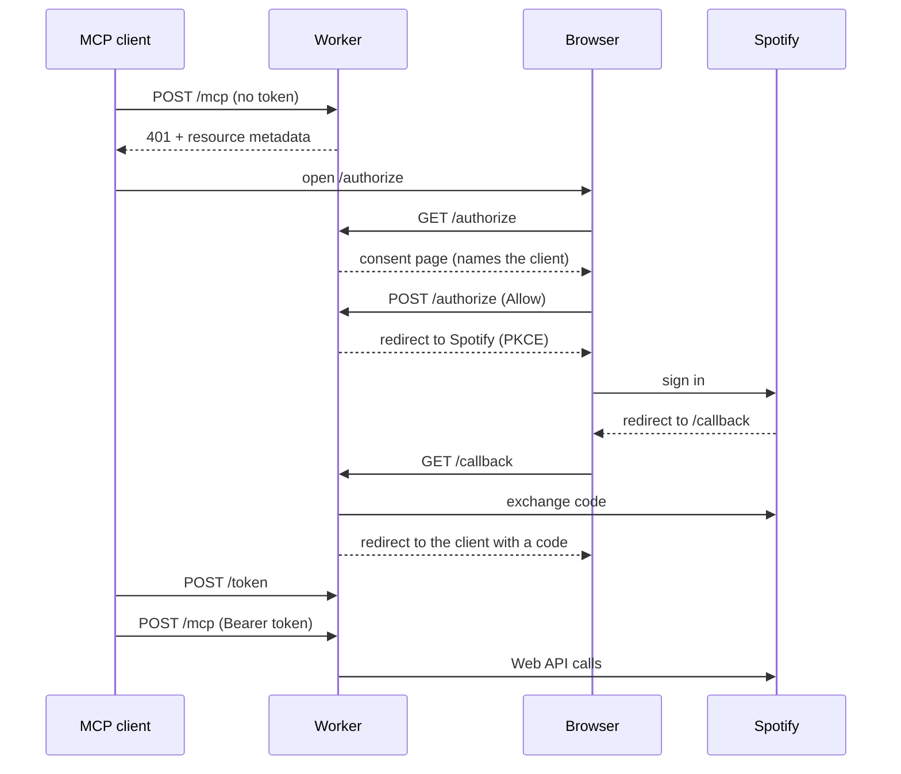

# Spotify Organiser on Cloudflare

This workspace is the Cloudflare Pages project behind https://spotify-organiser.pages.dev. Pages serves the web app from `dist` (Vite builds it there). The Pages Function in `functions/` runs `src/index.ts` for the paths in `../public/_routes.json`:

| Path                                                       | What                                                        |
| ---------------------------------------------------------- | ----------------------------------------------------------- |
| `/api/trpc/*`                                              | tRPC API for the web app (play and skip counts)             |
| `/mcp`                                                     | Remote MCP server, behind OAuth                             |
| `/authorize`, `/callback`, `/token`, `/register`, `/.well-known/*` | OAuth server for MCP clients                        |

It uses the same stack as Macromaxxing: Cloudflare Pages with Functions, Hono, D1, a tRPC router, and MCP SDK v1 with a stateless `WebStandardStreamableHTTPServerTransport` and `CfWorkerJsonSchemaValidator`. Macromaxxing signs people in with Clerk. Here Spotify is the only account, so the Worker runs its own OAuth server with [`@cloudflare/workers-oauth-provider`](https://github.com/cloudflare/workers-oauth-provider).

## Who the user is

- **Web app:** it sends its own Spotify access token. The Worker asks Spotify's `/me` whose token it is (remembered for five minutes) before it reads or writes that person's counts.
- **MCP clients:** they get our OAuth tokens after the flow below. The grant holds the person's Spotify refresh token, encrypted in KV.

- Clients register with Client ID Metadata Documents or Dynamic Client Registration (`/register`).
- The consent page runs before the Spotify redirect. Spotify skips its own consent screen for people who already approved Spotify Organiser, so this page is the only one that names the MCP client.
- Spotify sign-in uses PKCE with the app's public client ID. The Worker has no secrets.
- Our access token expires two minutes before Spotify's, and each refresh of our token also refreshes Spotify's.

## MCP tools

Every procedure in `src/lib/routes/` with `.meta({ description })` becomes a tool named `namespace_method`. `src/lib/mcp-tools.ts` derives the annotations from the procedure type and name, and a `.meta()` field overrides them. Results are JSON. Procedures without a description (`stats.all`, `stats.record`, `stats.clearSkips`) serve only the web app.

| Router     | Tools                                                                                                               |
| ---------- | ------------------------------------------------------------------------------------------------------------------- |
| `catalog`  | `catalog_search`                                                                                                    |
| `library`  | `library_savedTracks`, `library_contains`, `library_save`, `library_remove`                                         |
| `playlist` | `playlist_list`, `playlist_get`, `playlist_items`, `playlist_create`, `playlist_update`, `playlist_addItems`, `playlist_removeItems`, `playlist_reorder` |
| `player`   | `player_state`, `player_queue`, `player_devices`, `player_recentlyPlayed`, `player_play`, `player_pause`, `player_skip`, `player_addToQueue`, `player_setVolume`, `player_setShuffle`, `player_setRepeat`, `player_transfer` |
| `stats`    | `stats_forPlaylist`, `stats_mostSkipped`                                                                            |

`player_*` tools need Spotify Premium. The tools use the endpoints from Spotify's February 2026 Web API changes (`/playlists/{id}/items`, `/me/library`), so they work in development mode.

## Setup

1. In the [Spotify Developer Dashboard](https://developer.spotify.com/dashboard), the Spotify Organiser app lists these redirect URIs: `https://spotify-organiser.pages.dev` (web app login) and `https://spotify-organiser.pages.dev/callback` (MCP sign-in). For local development also add `http://127.0.0.1:1337` and `http://127.0.0.1:8788/callback`.
2. The repository needs the `CLOUDFLARE_API_TOKEN` and `CLOUDFLARE_ACCOUNT_ID` secrets. `deploy.yml` applies D1 migrations and deploys on every push to `master`. `preview.yml` deploys each PR to `pr-<number>.spotify-organiser.pages.dev`.

While the Spotify app is in development mode, only accounts on its user list can sign in.

## Development

| Task                 | Command                                                |
| -------------------- | ------------------------------------------------------ |
| Worker (port 8788)   | `yarn workspace spotify-organiser-workers dev`         |
| Local D1 migrations  | `yarn workspace spotify-organiser-workers db:migrate`  |
| Tests                | `yarn workspace spotify-organiser-workers test`        |
| Typecheck            | `yarn workspace spotify-organiser-workers typecheck`   |

Run `yarn prod` once so `dist` exists, then run the Worker next to `yarn dev`. Vite proxies the Worker's paths to port 8788.

The tests run `src/index.ts` in workerd through wrangler's `createTestHarness`, with `test/wrangler.jsonc` (the harness runs Workers, not Pages projects) and a fake Spotify server.
